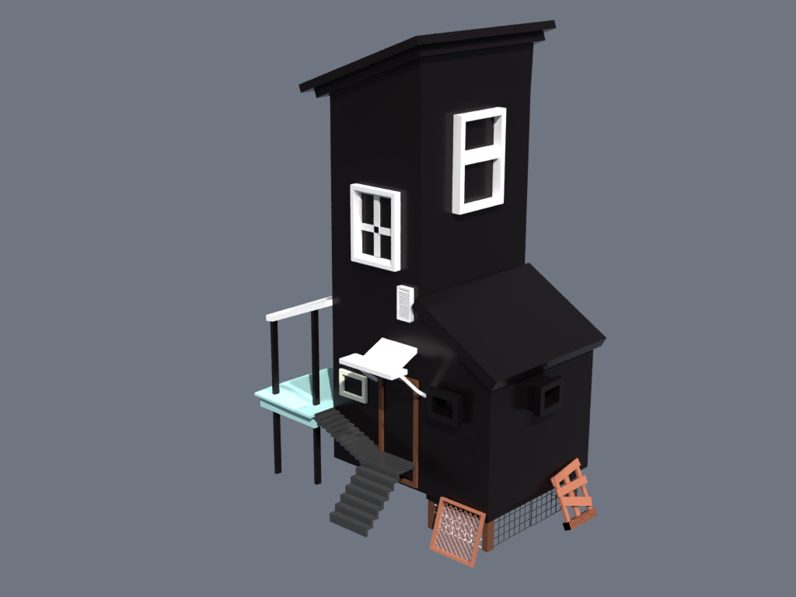
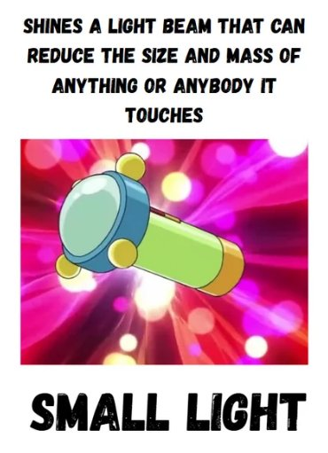

# Devil Home

A spooky 3D-printable miniature house made in Blender for Hack Club Embassy.

[](./journal.md)
[](./LICENSE)

- **Printables:** [devils-home](https://www.printables.com/model/1911676-devils-home)
- **Hackatime:** [phantom devil home](https://hackatime.hackclub.com/?project=phantom+devil+home)
- **Lapse:** [1st](https://lapse.hackclub.com/timelapse/8CNvf4QhE0jD) • [2nd](https://lapse.hackclub.com/timelapse/NIITMD0MiCXK) • [3rd](https://lapse.hackclub.com/timelapse/wBuoX2-fpzYO)



## what is this?

**Devil Home** is a 3D printable miniature model designed in Blender for Hack Club Embassy, inspired by a random Pinterest image. Looks kinda spooky and crooked, like a little house you could live in if you had a 3D printer and a small light!



## why i made this?

So yeah, I made this because as a beginner, it didn't feel too hard to make — I could just look at the reference picture, visualize what to do, and block it out piece by piece. That feeling of seeing an image and actually making it in 3D is why I made it.

## files in this repo

- `Devil Home.blend` - my original blender file (41 objects)
- `phantom devil home.stl` - fixed 3D printable file
- `journal.md` - my build log and timelapses
- `Bom.csv` - cost list

```text
├── src/
│   └── Devil Home.blend           # original Blender file
├── Production/
│   └── phantom devil home.stl     # 100mm 3D printable STL
├── renders/
│   └── phantom_devil_home_render.png # final beauty render
├── journal media/                 # progress photos, screenshots & timelapses
├── journal.md                     # build log and journal
├── Bom.csv                        # materials & cost list
├── Readme.md                      # project overview
└── LICENSE                        # MIT License
```

## modeling (cad)

I modeled the house in Blender starting from the default cube to the side house, roof, windows, the other house parts, gates, etc. In total, 41 objects were used, taking nearly 5 hours of modeling time combined as shown in the timelapses to shape it into the full house in the images!

Also, it's a cool design — if you've got any kids who wanna roam around near the home, also you can take care of the plants in the tent.

.png)

.png)

Full step-by-step modeling logs: [`journal.md`](./journal.md)

## rendering & colors

I first tried giving it the same colors as the original preview, but then I decided why not make it spooky even though Halloween isn't here! Switched to a full dark gothic theme. The metallic slider in Blender is an absolute 10/10 for giving the grills and planks that shiny look, lit with an isometric 55mm camera and 3-point studio lights (and our chimney disappeared from nowhere lol!).

.png)

## 3d printing

Some of the foundation grills were way too thin and the pieces weren't joined properly, so I used AI to help thicken them and merge everything into one solid STL.

Honestly, I've never used a 3D printer before in my life, but I'm really looking forward to learning how to make STLs and slice completely on my own next time!

.png)

### suggested print settings

Since I haven't printed this yet, these are the standard slicer settings I used to check the model in Bambu Studio:
- **Size:** 100mm tall (you can scale it up or down)
- **Layer height:** 0.2mm
- **Infill:** 15%
- **Supports:** Tree supports (needed under the porch and roof)
- **Estimated time:** ~3.5 hours

## parts & cost

I haven't printed this myself yet, so these are estimated material costs using standard PLA+ filament (around 63g total, which comes out to roughly $0.45 / ₹38 based on Numakers India's ₹600/kg price). Software used: Blender and Bambu Studio (both free).

Source file: [`Bom.csv`](Bom.csv)

| item | Quantity | price | link to buy |
| :--- | :--- | :--- | :--- |
| PLA+ Filament | 63g | $0.45 (₹38) | [Numakers PLA+](https://india.numakers.com/products/pla-filament) |
| **Total Estimated Material Cost** | **100mm Miniature** | **$0.45 USD** | *Estimated raw filament to print* |

---

Made for [Hack Club Embassy](https://embassy.hackclub.com) using Blender. Licensed under MIT.
